# Cronograma do Projeto — FieldOps

---

## Identificação

| Campo | Informação |
| --- | --- |
| **Projeto** | FieldOps — Plataforma de Inspeção em Campo |
| **Gerente do projeto** | DevOps (papel de gerenciamento) |
| **Patrocinador** | Instituição |
| **Data de elaboração** | 05/11/2026 |
| **Versão** | 1.0 — proposta para validação |
| **Início previsto** | 09/11/2026 |
| **Término previsto** | 17/12/2026 |
| **Premissa de calendário** | Datas e durações preliminares em dias corridos; confirmar com a equipe e o calendário acadêmico. |

---

## Cronograma

```mermaid
gantt
    title Cronograma proposto do Projeto FieldOps
    dateFormat  DD/MM/YYYY
    axisFormat  %d/%m

    section 1. Gestão e planejamento
    A01 Consolidação do TAP e autorização do projeto :a01, 09/11/2026, 1d
    A02 Identificação e validação das partes interessadas :a02, 09/11/2026, 1d
    A03 Consolidação dos objetivos e critérios de sucesso :a03, 10/11/2026, 1d
    A04 Revisão do escopo e das premissas do FieldOps :a04, 10/11/2026, 1d
    A05 Consolidação dos requisitos funcionais :a05, 11/11/2026, 2d
    A06 Consolidação dos requisitos não funcionais :a06, 11/11/2026, 2d
    A07 Revisão e priorização do backlog :a07, 13/11/2026, 1d
    A08 Validação da EAP e do dicionário da EAP :a08, 14/11/2026, 1d
    A09 Definição da linha de base do cronograma :a09, 15/11/2026, 1d

    section 2. Governança e infraestrutura
    A10 Definição dos padrões de branches e commits :a10, 10/11/2026, 1d
    A11 Padronização dos repositórios da API, mobile e admin :a11, 11/11/2026, 2d
    A12 Documentação do fluxo de contribuição e Pull Request :a12, 13/11/2026, 1d
    A13 Configuração das regras de proteção da branch principal :a13, 14/11/2026, 1d
    A14 Configuração inicial da integração contínua :a14, 14/11/2026, 2d
    A15 Definição da arquitetura e contratos de integração :a15, 13/11/2026, 2d

    section 3. API / Backend
    A16 Modelagem dos dados de clientes, locais e equipamentos :a16, 15/11/2026, 2d
    A17 Implementação dos serviços de clientes, locais e equipamentos :a17, 17/11/2026, 2d
    A18 Implementação da identificação de equipamentos por QR Code na API :a18, 19/11/2026, 2d
    A19 Modelagem dos modelos, seções e itens de inspeção :a19, 15/11/2026, 2d
    A20 Implementação dos serviços de modelos de inspeção :a20, 17/11/2026, 2d
    A21 Implementação dos serviços de planejamento de inspeções :a21, 19/11/2026, 2d
    A22 Implementação dos serviços de execução e respostas :a22, 21/11/2026, 2d
    A23 Implementação do suporte a evidências na API :a23, 23/11/2026, 2d

    section 4. Painel administrativo
    A24 Configuração da estrutura base do painel administrativo :a24, 15/11/2026, 1d
    A25 Implementação das telas de clientes, locais e equipamentos :a25, 19/11/2026, 2d
    A26 Implementação das telas de modelos de inspeção :a26, 19/11/2026, 2d
    A27 Implementação das telas de planejamento de inspeções :a27, 21/11/2026, 2d
    A28 Implementação das telas de acompanhamento de inspeções :a28, 23/11/2026, 2d

    section 5. Aplicativo móvel
    A29 Configuração da estrutura base do aplicativo móvel :a29, 15/11/2026, 1d
    A30 Implementação da consulta de inspeções no aplicativo :a30, 21/11/2026, 2d
    A31 Implementação do fluxo de execução de inspeções :a31, 23/11/2026, 2d
    A32 Implementação do checklist dinâmico e registro de respostas :a32, 25/11/2026, 2d
    A33 Implementação da leitura de QR Code no aplicativo :a33, 25/11/2026, 2d
    A34 Implementação da captura de fotografia e prévia :a34, 27/11/2026, 2d
    A35 Implementação do registro e envio de evidências :a35, 29/11/2026, 2d
    A36 Implementação do tratamento de envios pendentes :a36, 01/12/2026, 2d
    A37 Implementação do registro de localização e não conformidades :a37, 01/12/2026, 2d

    section 6. Integração, testes e entrega
    A38 Integração do painel administrativo com a API :a38, 25/11/2026, 2d
    A39 Integração do aplicativo móvel com a API :a39, 03/12/2026, 2d
    A40 Validação dos fluxos de cadastro e consulta :a40, 05/12/2026, 1d
    A41 Validação dos fluxos de modelos de inspeção :a41, 27/11/2026, 1d
    A42 Validação do planejamento e atribuição de inspeções :a42, 06/12/2026, 1d
    A43 Validação da execução de inspeções no aplicativo :a43, 05/12/2026, 1d
    A44 Validação de leitura de QR Code e confirmação de equipamento :a44, 06/12/2026, 1d
    A45 Validação de captura, prévia e envio de evidências :a45, 06/12/2026, 1d
    A46 Execução dos testes de integração entre os componentes :a46, 07/12/2026, 1d
    A47 Correção dos defeitos identificados na validação :a47, 08/12/2026, 2d
    A48 Execução da validação automatizada da API e da integração contínua :a48, 10/12/2026, 1d
    A49 Revisão de segurança, permissões e configurações :a49, 10/12/2026, 1d
    A50 Homologação da versão integrada do FieldOps :a50, 11/12/2026, 1d
    A51 Consolidação da documentação técnica e de uso :a51, 12/12/2026, 1d
    A52 Preparação da versão final para apresentação :a52, 13/12/2026, 1d
    A53 Apresentação e aceite acadêmico do projeto :a53, 14/12/2026, 1d
    A54 Registro das lições aprendidas :a54, 15/12/2026, 1d
    A55 Encerramento e entrega final do projeto :a55, 16/12/2026, 1d

    section Marcos
    TAP e escopo consolidados :milestone, m1, 17/11/2026, 0d
    Base de desenvolvimento configurada :milestone, m2, 21/11/2026, 0d
    Componentes em integração :milestone, m3, 02/12/2026, 0d
    Testes integrados concluídos :milestone, m4, 10/12/2026, 0d
    Homologação concluída :milestone, m5, 13/12/2026, 0d
    Entrega final :milestone, m6, 17/12/2026, 0d
```

> **Atenção:** este é um cronograma-base proposto para a atividade, não um registro confirmado do planejamento oficial da equipe. As datas foram projetadas de 09/11/2026 a 17/12/2026. As durações são estimativas preliminares em dias corridos e devem ser validadas com o calendário acadêmico, a disponibilidade dos integrantes e o progresso já realizado. As dependências foram consideradas para evitar que uma atividade comece antes das atividades predecessoras.

---

## Lista de Atividades

Total: **55 atividades**, atendendo ao mínimo de 50 itens solicitado na Aula 04.

| ID | Atividade | Início | Término | Duração | Responsável | Dependência | Status |
| --- | --- | --- | --- | ---: | --- | --- | --- |
| A01 | Consolidação do TAP e autorização do projeto | 09/11/2026 | 09/11/2026 | 1 dias | Gerente do projeto / DevOps | — | ⬜ A validar |
| A02 | Identificação e validação das partes interessadas | 09/11/2026 | 09/11/2026 | 1 dias | Gerente do projeto / DevOps | — | ⬜ A validar |
| A03 | Consolidação dos objetivos e critérios de sucesso | 10/11/2026 | 10/11/2026 | 1 dias | Gerente do projeto / DevOps | A01 | ⬜ A validar |
| A04 | Revisão do escopo e das premissas do FieldOps | 10/11/2026 | 10/11/2026 | 1 dias | Gerente do projeto / DevOps | A01, A02 | ⬜ A validar |
| A05 | Consolidação dos requisitos funcionais | 11/11/2026 | 12/11/2026 | 2 dias | Analista de requisitos / equipe | A03, A04 | ⬜ A validar |
| A06 | Consolidação dos requisitos não funcionais | 11/11/2026 | 12/11/2026 | 2 dias | Analista de requisitos / equipe | A03, A04 | ⬜ A validar |
| A07 | Revisão e priorização do backlog | 13/11/2026 | 13/11/2026 | 1 dias | Product Owner / equipe | A05, A06 | ⬜ A validar |
| A08 | Validação da EAP e do dicionário da EAP | 14/11/2026 | 14/11/2026 | 1 dias | Gerente do projeto / DevOps | A07 | ⬜ A validar |
| A09 | Definição da linha de base do cronograma | 15/11/2026 | 15/11/2026 | 1 dias | Gerente do projeto / DevOps | A08 | ⬜ A validar |
| A10 | Definição dos padrões de branches e commits | 10/11/2026 | 10/11/2026 | 1 dias | DevOps | A01 | ⬜ A validar |
| A11 | Padronização dos repositórios da API, mobile e admin | 11/11/2026 | 12/11/2026 | 2 dias | DevOps / responsáveis dos repositórios | A10 | ⬜ A validar |
| A12 | Documentação do fluxo de contribuição e Pull Request | 13/11/2026 | 13/11/2026 | 1 dias | DevOps | A11 | ⬜ A validar |
| A13 | Configuração das regras de proteção da branch principal | 14/11/2026 | 14/11/2026 | 1 dias | DevOps | A12 | ⬜ A validar |
| A14 | Configuração inicial da integração contínua | 14/11/2026 | 15/11/2026 | 2 dias | DevOps / equipe de API | A11, A12 | ⬜ A validar |
| A15 | Definição da arquitetura e contratos de integração | 13/11/2026 | 14/11/2026 | 2 dias | Líder técnico / equipes | A05, A06 | ⬜ A validar |
| A16 | Modelagem dos dados de clientes, locais e equipamentos | 15/11/2026 | 16/11/2026 | 2 dias | Equipe de API | A15 | ⬜ A validar |
| A17 | Implementação dos serviços de clientes, locais e equipamentos | 17/11/2026 | 18/11/2026 | 2 dias | Equipe de API | A16 | ⬜ A validar |
| A18 | Implementação da identificação de equipamentos por QR Code na API | 19/11/2026 | 20/11/2026 | 2 dias | Equipe de API | A17 | ⬜ A validar |
| A19 | Modelagem dos modelos, seções e itens de inspeção | 15/11/2026 | 16/11/2026 | 2 dias | Equipe de API | A15 | ⬜ A validar |
| A20 | Implementação dos serviços de modelos de inspeção | 17/11/2026 | 18/11/2026 | 2 dias | Equipe de API | A19 | ⬜ A validar |
| A21 | Implementação dos serviços de planejamento de inspeções | 19/11/2026 | 20/11/2026 | 2 dias | Equipe de API | A17, A20 | ⬜ A validar |
| A22 | Implementação dos serviços de execução e respostas | 21/11/2026 | 22/11/2026 | 2 dias | Equipe de API | A20, A21 | ⬜ A validar |
| A23 | Implementação do suporte a evidências na API | 23/11/2026 | 24/11/2026 | 2 dias | Equipe de API | A20, A22 | ⬜ A validar |
| A24 | Configuração da estrutura base do painel administrativo | 15/11/2026 | 15/11/2026 | 1 dias | Equipe Admin | A15 | ⬜ A validar |
| A25 | Implementação das telas de clientes, locais e equipamentos | 19/11/2026 | 20/11/2026 | 2 dias | Equipe Admin | A17, A24 | ⬜ A validar |
| A26 | Implementação das telas de modelos de inspeção | 19/11/2026 | 20/11/2026 | 2 dias | Equipe Admin | A20, A24 | ⬜ A validar |
| A27 | Implementação das telas de planejamento de inspeções | 21/11/2026 | 22/11/2026 | 2 dias | Equipe Admin | A21, A25, A26 | ⬜ A validar |
| A28 | Implementação das telas de acompanhamento de inspeções | 23/11/2026 | 24/11/2026 | 2 dias | Equipe Admin | A27, A22 | ⬜ A validar |
| A29 | Configuração da estrutura base do aplicativo móvel | 15/11/2026 | 15/11/2026 | 1 dias | Equipe Mobile | A15 | ⬜ A validar |
| A30 | Implementação da consulta de inspeções no aplicativo | 21/11/2026 | 22/11/2026 | 2 dias | Equipe Mobile | A21, A29 | ⬜ A validar |
| A31 | Implementação do fluxo de execução de inspeções | 23/11/2026 | 24/11/2026 | 2 dias | Equipe Mobile | A22, A30 | ⬜ A validar |
| A32 | Implementação do checklist dinâmico e registro de respostas | 25/11/2026 | 26/11/2026 | 2 dias | Equipe Mobile | A31 | ⬜ A validar |
| A33 | Implementação da leitura de QR Code no aplicativo | 25/11/2026 | 26/11/2026 | 2 dias | Equipe Mobile | A18, A31 | ⬜ A validar |
| A34 | Implementação da captura de fotografia e prévia | 27/11/2026 | 28/11/2026 | 2 dias | Equipe Mobile | A23, A32 | ⬜ A validar |
| A35 | Implementação do registro e envio de evidências | 29/11/2026 | 30/11/2026 | 2 dias | Equipe Mobile | A23, A34 | ⬜ A validar |
| A36 | Implementação do tratamento de envios pendentes | 01/12/2026 | 02/12/2026 | 2 dias | Equipe Mobile | A35 | ⬜ A validar |
| A37 | Implementação do registro de localização e não conformidades | 01/12/2026 | 02/12/2026 | 2 dias | Equipe Mobile | A32, A35 | ⬜ A validar |
| A38 | Integração do painel administrativo com a API | 25/11/2026 | 26/11/2026 | 2 dias | Equipes Admin e API | A25, A26, A27, A28, A22 | ⬜ A validar |
| A39 | Integração do aplicativo móvel com a API | 03/12/2026 | 04/12/2026 | 2 dias | Equipes Mobile e API | A30, A31, A32, A33, A35, A36, A37 | ⬜ A validar |
| A40 | Validação dos fluxos de cadastro e consulta | 05/12/2026 | 05/12/2026 | 1 dias | QA / equipes responsáveis | A38, A39 | ⬜ A validar |
| A41 | Validação dos fluxos de modelos de inspeção | 27/11/2026 | 27/11/2026 | 1 dias | QA / equipes Admin e API | A38 | ⬜ A validar |
| A42 | Validação do planejamento e atribuição de inspeções | 06/12/2026 | 06/12/2026 | 1 dias | QA / equipes Admin e API | A40, A41 | ⬜ A validar |
| A43 | Validação da execução de inspeções no aplicativo | 05/12/2026 | 05/12/2026 | 1 dias | QA / equipes Mobile e API | A39 | ⬜ A validar |
| A44 | Validação de leitura de QR Code e confirmação de equipamento | 06/12/2026 | 06/12/2026 | 1 dias | QA / equipe Mobile | A43 | ⬜ A validar |
| A45 | Validação de captura, prévia e envio de evidências | 06/12/2026 | 06/12/2026 | 1 dias | QA / equipes Mobile e API | A43 | ⬜ A validar |
| A46 | Execução dos testes de integração entre os componentes | 07/12/2026 | 07/12/2026 | 1 dias | QA / equipes API, Admin e Mobile | A42, A43, A44, A45 | ⬜ A validar |
| A47 | Correção dos defeitos identificados na validação | 08/12/2026 | 09/12/2026 | 2 dias | Equipes API, Admin e Mobile | A46 | ⬜ A validar |
| A48 | Execução da validação automatizada da API e da integração contínua | 10/12/2026 | 10/12/2026 | 1 dias | DevOps / equipe de API | A14, A47 | ⬜ A validar |
| A49 | Revisão de segurança, permissões e configurações | 10/12/2026 | 10/12/2026 | 1 dias | DevOps / líderes técnicos | A47 | ⬜ A validar |
| A50 | Homologação da versão integrada do FieldOps | 11/12/2026 | 11/12/2026 | 1 dias | Representantes dos usuários / equipe | A47, A48, A49 | ⬜ A validar |
| A51 | Consolidação da documentação técnica e de uso | 12/12/2026 | 12/12/2026 | 1 dias | DevOps / equipes | A50 | ⬜ A validar |
| A52 | Preparação da versão final para apresentação | 13/12/2026 | 13/12/2026 | 1 dias | Gerente do projeto / equipes | A51 | ⬜ A validar |
| A53 | Apresentação e aceite acadêmico do projeto | 14/12/2026 | 14/12/2026 | 1 dias | Gerente do projeto / equipe | A52 | ⬜ A validar |
| A54 | Registro das lições aprendidas | 15/12/2026 | 15/12/2026 | 1 dias | Gerente do projeto / equipe | A53 | ⬜ A validar |
| A55 | Encerramento e entrega final do projeto | 16/12/2026 | 16/12/2026 | 1 dias | Gerente do projeto / equipe | A54 | ⬜ A validar |

---

## Dependências

As relações abaixo foram propostas considerando a sequência lógica das entregas. Atividades sem dependência explícita podem ocorrer em paralelo, desde que haja recursos disponíveis.

| Atividade | Depende de | Relação |
| --- | --- | --- |
| A01 — Consolidação do TAP e autorização do projeto | — | Pode iniciar no começo do planejamento, conforme disponibilidade. |
| A02 — Identificação e validação das partes interessadas | — | Pode iniciar no começo do planejamento, conforme disponibilidade. |
| A03 — Consolidação dos objetivos e critérios de sucesso | A01 | Iniciar após a conclusão das dependências indicadas. |
| A04 — Revisão do escopo e das premissas do FieldOps | A01, A02 | Iniciar após a conclusão das dependências indicadas. |
| A05 — Consolidação dos requisitos funcionais | A03, A04 | Iniciar após a conclusão das dependências indicadas. |
| A06 — Consolidação dos requisitos não funcionais | A03, A04 | Iniciar após a conclusão das dependências indicadas. |
| A07 — Revisão e priorização do backlog | A05, A06 | Iniciar após a conclusão das dependências indicadas. |
| A08 — Validação da EAP e do dicionário da EAP | A07 | Iniciar após a conclusão das dependências indicadas. |
| A09 — Definição da linha de base do cronograma | A08 | Iniciar após a conclusão das dependências indicadas. |
| A10 — Definição dos padrões de branches e commits | A01 | Iniciar após a conclusão das dependências indicadas. |
| A11 — Padronização dos repositórios da API, mobile e admin | A10 | Iniciar após a conclusão das dependências indicadas. |
| A12 — Documentação do fluxo de contribuição e Pull Request | A11 | Iniciar após a conclusão das dependências indicadas. |
| A13 — Configuração das regras de proteção da branch principal | A12 | Iniciar após a conclusão das dependências indicadas. |
| A14 — Configuração inicial da integração contínua | A11, A12 | Iniciar após a conclusão das dependências indicadas. |
| A15 — Definição da arquitetura e contratos de integração | A05, A06 | Iniciar após a conclusão das dependências indicadas. |
| A16 — Modelagem dos dados de clientes, locais e equipamentos | A15 | Iniciar após a conclusão das dependências indicadas. |
| A17 — Implementação dos serviços de clientes, locais e equipamentos | A16 | Iniciar após a conclusão das dependências indicadas. |
| A18 — Implementação da identificação de equipamentos por QR Code na API | A17 | Iniciar após a conclusão das dependências indicadas. |
| A19 — Modelagem dos modelos, seções e itens de inspeção | A15 | Iniciar após a conclusão das dependências indicadas. |
| A20 — Implementação dos serviços de modelos de inspeção | A19 | Iniciar após a conclusão das dependências indicadas. |
| A21 — Implementação dos serviços de planejamento de inspeções | A17, A20 | Iniciar após a conclusão das dependências indicadas. |
| A22 — Implementação dos serviços de execução e respostas | A20, A21 | Iniciar após a conclusão das dependências indicadas. |
| A23 — Implementação do suporte a evidências na API | A20, A22 | Iniciar após a conclusão das dependências indicadas. |
| A24 — Configuração da estrutura base do painel administrativo | A15 | Iniciar após a conclusão das dependências indicadas. |
| A25 — Implementação das telas de clientes, locais e equipamentos | A17, A24 | Iniciar após a conclusão das dependências indicadas. |
| A26 — Implementação das telas de modelos de inspeção | A20, A24 | Iniciar após a conclusão das dependências indicadas. |
| A27 — Implementação das telas de planejamento de inspeções | A21, A25, A26 | Iniciar após a conclusão das dependências indicadas. |
| A28 — Implementação das telas de acompanhamento de inspeções | A27, A22 | Iniciar após a conclusão das dependências indicadas. |
| A29 — Configuração da estrutura base do aplicativo móvel | A15 | Iniciar após a conclusão das dependências indicadas. |
| A30 — Implementação da consulta de inspeções no aplicativo | A21, A29 | Iniciar após a conclusão das dependências indicadas. |
| A31 — Implementação do fluxo de execução de inspeções | A22, A30 | Iniciar após a conclusão das dependências indicadas. |
| A32 — Implementação do checklist dinâmico e registro de respostas | A31 | Iniciar após a conclusão das dependências indicadas. |
| A33 — Implementação da leitura de QR Code no aplicativo | A18, A31 | Iniciar após a conclusão das dependências indicadas. |
| A34 — Implementação da captura de fotografia e prévia | A23, A32 | Iniciar após a conclusão das dependências indicadas. |
| A35 — Implementação do registro e envio de evidências | A23, A34 | Iniciar após a conclusão das dependências indicadas. |
| A36 — Implementação do tratamento de envios pendentes | A35 | Iniciar após a conclusão das dependências indicadas. |
| A37 — Implementação do registro de localização e não conformidades | A32, A35 | Iniciar após a conclusão das dependências indicadas. |
| A38 — Integração do painel administrativo com a API | A25, A26, A27, A28, A22 | Iniciar após a conclusão das dependências indicadas. |
| A39 — Integração do aplicativo móvel com a API | A30, A31, A32, A33, A35, A36, A37 | Iniciar após a conclusão das dependências indicadas. |
| A40 — Validação dos fluxos de cadastro e consulta | A38, A39 | Iniciar após a conclusão das dependências indicadas. |
| A41 — Validação dos fluxos de modelos de inspeção | A38 | Iniciar após a conclusão das dependências indicadas. |
| A42 — Validação do planejamento e atribuição de inspeções | A40, A41 | Iniciar após a conclusão das dependências indicadas. |
| A43 — Validação da execução de inspeções no aplicativo | A39 | Iniciar após a conclusão das dependências indicadas. |
| A44 — Validação de leitura de QR Code e confirmação de equipamento | A43 | Iniciar após a conclusão das dependências indicadas. |
| A45 — Validação de captura, prévia e envio de evidências | A43 | Iniciar após a conclusão das dependências indicadas. |
| A46 — Execução dos testes de integração entre os componentes | A42, A43, A44, A45 | Iniciar após a conclusão das dependências indicadas. |
| A47 — Correção dos defeitos identificados na validação | A46 | Iniciar após a conclusão das dependências indicadas. |
| A48 — Execução da validação automatizada da API e da integração contínua | A14, A47 | Iniciar após a conclusão das dependências indicadas. |
| A49 — Revisão de segurança, permissões e configurações | A47 | Iniciar após a conclusão das dependências indicadas. |
| A50 — Homologação da versão integrada do FieldOps | A47, A48, A49 | Iniciar após a conclusão das dependências indicadas. |
| A51 — Consolidação da documentação técnica e de uso | A50 | Iniciar após a conclusão das dependências indicadas. |
| A52 — Preparação da versão final para apresentação | A51 | Iniciar após a conclusão das dependências indicadas. |
| A53 — Apresentação e aceite acadêmico do projeto | A52 | Iniciar após a conclusão das dependências indicadas. |
| A54 — Registro das lições aprendidas | A53 | Iniciar após a conclusão das dependências indicadas. |
| A55 — Encerramento e entrega final do projeto | A54 | Iniciar após a conclusão das dependências indicadas. |

---

## Marcos do Projeto

| Marco | Data prevista | Critério |
| --- | --- | --- |
| 🚀 Início do planejamento | 09/11/2026 | Cronograma-base iniciado e atividades organizadas. |
| 📋 TAP, escopo e EAP consolidados | 17/11/2026 | Documentos e escopo revisados para orientar o trabalho. |
| 🛠️ Base de desenvolvimento configurada | 21/11/2026 | Repositórios, fluxo de contribuição e CI inicial organizados. |
| 🔌 Componentes prontos para integração | 02/12/2026 | Funcionalidades previstas nos componentes disponíveis para integração. |
| 🧪 Testes integrados concluídos | 10/12/2026 | Fluxos integrados validados e defeitos críticos tratados. |
| ✅ Homologação concluída | 13/12/2026 | Versão integrada validada pelos representantes definidos pela equipe. |
| 🏁 Encerramento e entrega final | 17/12/2026 | Documentação, apresentação e entrega acadêmica concluídas. |

---

## Responsáveis

| Responsável / papel | Atividades |
| --- | --- |
| Gerente do projeto / DevOps | TAP, escopo, EAP, cronograma, governança, repositórios, CI, acompanhamento, documentação e encerramento. |
| Product Owner / responsável pelo produto | Priorização e validação do backlog e dos requisitos, conforme organização da equipe. |
| Equipe de API | Serviços backend, modelos de dados, regras de negócio, integração e correções da API. |
| Equipe Admin | Interfaces do painel administrativo e integração com a API. |
| Equipe Mobile | Aplicativo móvel, execução de inspeções, QR Code, evidências e integração com a API. |
| Representantes dos usuários / equipe | Homologação e aceite dos resultados, conforme disponibilidade e definição da instituição. |

---

## ✅ Checklist

- [x] Todas as atividades foram identificadas (55 itens).
- [x] As atividades possuem responsáveis por papel/equipe.
- [x] As datas de início foram propostas.
- [x] As datas de término foram propostas.
- [x] As durações foram estimadas.
- [x] As dependências foram identificadas.
- [x] Os principais marcos foram definidos.
- [ ] O cronograma foi revisado e aprovado pela equipe.
- [ ] O cronograma foi atualizado com o progresso real.
- [ ] Os atrasos e impactos reais foram registrados, se houver.
