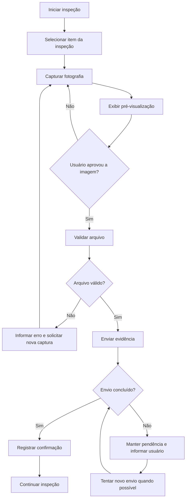

# Análise da Qualidade — FieldOps

## 1. Identificação

| Campo | Informação |
| --- | --- |
| Projeto | FieldOps — Plataforma de Inspeção em Campo |
| Gerente do projeto | DevOps |
| Patrocinador | Instituição |
| Versão | 1.0 |
| Data | 07/11/2026 |

## 2. Objetivo

Aplicar as sete ferramentas básicas da qualidade para organizar a identificação, análise e acompanhamento de possíveis problemas no FieldOps.

O foco considera os componentes conhecidos do projeto: API, painel administrativo e aplicativo móvel, incluindo cadastro e consulta de informações operacionais, inspeções, identificação de equipamentos por QR Code e registro de evidências.

**Importante:** os números apresentados nas ferramentas quantitativas são dados simulados para demonstrar a aplicação acadêmica. Não são resultados de testes reais do FieldOps.

## 3. Critérios iniciais de qualidade

| Dimensão | Critério proposto |
| --- | --- |
| Funcionalidade | Os fluxos implementados devem atender aos requisitos priorizados e critérios de aceite |
| Integração | Mobile e painel devem trocar dados com a API conforme contratos definidos |
| Confiabilidade | Erros devem ser tratados sem perda indevida de dados |
| Usabilidade | O técnico deve conseguir executar o fluxo de inspeção com clareza |
| Segurança | Acesso e operações devem respeitar autenticação e autorização definidas |
| Evidências | Fotografias devem ser capturadas, visualizadas e enviadas conforme o fluxo implementado |
| Rastreabilidade | Defeitos, testes e alterações devem ser registrados |

## 4. Ferramentas básicas da qualidade

### 4.1 Diagrama de causa e efeito (Ishikawa)

**Problema analisado:** falha no envio ou registro de evidências fotográficas durante uma inspeção.

Possíveis causas:

| Categoria | Possíveis causas |
| --- | --- |
| Pessoas | Falta de orientação sobre o fluxo; execução incorreta do procedimento |
| Métodos | Critérios de aceite incompletos; ausência de tratamento definido para falha de envio |
| Tecnologia | Instabilidade da API; erro no armazenamento; incompatibilidade entre versões |
| Ambiente | Conexão de internet instável; permissões da câmera não concedidas |
| Dados | Arquivo em formato não aceito; tamanho acima do limite; metadados inválidos |
| Medição | Falta de logs; ausência de indicador de sucesso e falha no envio |

**Ação sugerida:** documentar o fluxo esperado, validar permissões e formatos, testar diferentes condições de rede e registrar logs que permitam identificar a etapa em que ocorre a falha.

### 4.2 Fluxograma do processo

Fluxo proposto para registrar uma evidência fotográfica:

O fluxo é uma proposta de validação e deve ser ajustado ao comportamento realmente implementado.

### 4.3 Folha de verificação

**Exemplo de folha simulada:** registro de 30 ocorrências hipotéticas encontradas em uma rodada de testes.

| Tipo de ocorrência | Quantidade simulada |
| --- | ---: |
| Falha de integração entre Mobile e API | 8 |
| Erro no envio de fotografia | 7 |
| Validação incorreta de campos | 5 |
| Problema na leitura de QR Code | 4 |
| Falha de autenticação/autorização | 3 |
| Problema de usabilidade | 2 |
| Erro de registro de inspeção | 1 |
| **Total** | **30** |

A folha real deverá registrar data, versão testada, responsável, funcionalidade, tipo de defeito, evidência e situação da correção.

### 4.4 Diagrama de Pareto

Utilizando os dados simulados da folha de verificação:

| Ocorrência | Quantidade | Percentual | Percentual acumulado |
| --- | ---: | ---: | ---: |
| Integração Mobile/API | 8 | 26,7% | 26,7% |
| Envio de fotografia | 7 | 23,3% | 50,0% |
| Validação de campos | 5 | 16,7% | 66,7% |
| Leitura de QR Code | 4 | 13,3% | 80,0% |
| Autenticação/autorização | 3 | 10,0% | 90,0% |
| Usabilidade | 2 | 6,7% | 96,7% |
| Registro de inspeção | 1 | 3,3% | 100,0% |

**Interpretação:** no exemplo, as quatro primeiras categorias concentram 80% das ocorrências. Portanto, seriam priorizadas para investigação e correção. Essa conclusão vale somente para os dados simulados.

### 4.5 Histograma

Exemplo de distribuição simulada do tempo de resposta de 20 operações de teste (em segundos):

| Faixa de tempo | Quantidade simulada |
| --- | ---: |
| 0,0 a 0,5 s | 3 |
| 0,5 a 1,0 s | 6 |
| 1,0 a 1,5 s | 5 |
| 1,5 a 2,0 s | 4 |
| 2,0 a 2,5 s | 2 |
| **Total** | **20** |

**Interpretação:** o exemplo mostra maior concentração entre 0,5 e 1,5 segundo. Para avaliar desempenho de verdade, será necessário coletar tempos de operações identificadas, em ambiente e condições de teste documentados.

### 4.6 Gráfico de controle

Exemplo simulado de quantidade de defeitos encontrados em oito ciclos de teste:

| Ciclo | Defeitos encontrados |
| --- | ---: |
| 1 | 12 |
| 2 | 10 |
| 3 | 11 |
| 4 | 8 |
| 5 | 9 |
| 6 | 6 |
| 7 | 5 |
| 8 | 4 |

Média dos valores: 8,125 defeitos por ciclo.

**Interpretação:** os valores simulados apresentam tendência de redução, o que poderia indicar melhoria após correções. Para um gráfico de controle estatístico formal, os limites de controle devem ser calculados conforme o tipo de dado e um conjunto real de observações; a tabela acima é apenas ilustrativa.

### 4.7 Diagrama de dispersão

Exemplo de dados simulados para investigar a relação entre cobertura de testes e quantidade de defeitos encontrados:

| Cobertura de testes | Defeitos encontrados |
| ---: | ---: |
| 30% | 15 |
| 40% | 14 |
| 50% | 12 |
| 60% | 10 |
| 70% | 8 |
| 80% | 7 |
| 90% | 5 |

**Interpretação:** no exemplo, há uma tendência inversa: à medida que a cobertura aumenta, a quantidade de defeitos encontrados diminui. Isso não prova causalidade e não significa que maior cobertura sempre elimina defeitos. A análise real deverá considerar também a qualidade dos casos de teste e a complexidade das funcionalidades.

## 5. Plano de aplicação da qualidade

| Etapa | Atividade | Responsável sugerido | Evidência |
| --- | --- | --- | --- |
| Planejar | Definir critérios de aceite e estratégia de testes | QA e Product Owner | Plano de testes |
| Garantir | Revisar processos, padrões e critérios durante o desenvolvimento | Líderes técnicos e DevOps | Revisões e registros |
| Controlar | Executar testes e registrar resultados | QA e equipes dos componentes | Casos de teste e defeitos |
| Corrigir | Priorizar e corrigir defeitos | Equipe responsável pelo componente | Pull requests e histórico |
| Revalidar | Reexecutar testes após correções | QA | Resultado de reteste |

## 6. Conclusão

As sete ferramentas ajudam a identificar causas, visualizar processos, registrar ocorrências, priorizar problemas e acompanhar resultados. No FieldOps, podem apoiar especialmente a qualidade da integração entre API, painel e aplicativo móvel, além dos fluxos de QR Code, inspeção e evidências.

Os dados quantitativos deste documento são exemplos simulados. Antes da entrega como relatório de resultados, devem ser substituídos por dados coletados em testes reais ou identificados explicitamente como simulação didática.

## 7. Checklist

- [ ] Validar critérios de qualidade com a equipe.
- [ ] Definir casos de teste e responsáveis.
- [ ] Coletar dados reais de execução.
- [ ] Substituir ou manter identificados os dados simulados.
- [ ] Registrar defeitos e evidências.
- [ ] Priorizar correções e realizar retestes.
- [ ] Armazenar os resultados no repositório do projeto.
